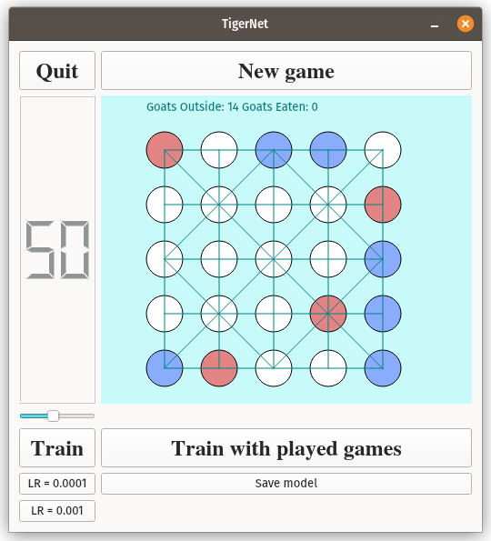

# TigerNet

A program to train a simple neural net for the Tiger player of the boad game Baghchal.

The neural net training is implemented using `PyTorch`. A simple GUI is implemented using `PySide6`. 

Trained models can be saved as `onnx` models using [torch.onnx](https://pytorch.org/docs/stable/onnx.html) and loaded using onnx web runtime to run the models on web applications. One such saved model is deployed using onnx web runtime at https://sarojadhikari.github.io/TigerNet/. 

## TigerNet Play (new web app)

[`docs/play/`](docs/play/) is a separate, dependency-free web app, served at https://sarojadhikari.github.io/TigerNet/play/ once GitHub Pages deploys it. It has:

* A full Baghchal rules engine (placement and movement phases, captures, trapped tigers, and draws by threefold repetition or 100 quiet plies).
* Play as goat or tiger, or watch two AIs. The players are Random, Greedy, Minimax (alpha-beta) and MCTS, all running in a Web Worker, plus the original TigerNet ONNX model.
* A loader for **policy-value ONNX models** that follow the contract in [`PLAN_RL_SELFPLAY.md`](PLAN_RL_SELFPLAY.md), which is the output of the planned self-play training. These models can play either side.
* Live MCTS analysis with move arrows and an evaluation bar, hints, highlighting of threatened goats and unsafe points, undo/redo, a clickable move history and shareable game links.
* An **Arena** tab that runs many engine-vs-engine games and reports win/draw/loss.

To run it locally, serve the `docs` folder (for example `python3 -m http.server -d docs`) and open `http://localhost:8000/play/`. Run the engine tests with `node --test tests/web/*.test.mjs`.

## Reinforcement learning plan

[`PLAN_RL_SELFPLAY.md`](PLAN_RL_SELFPLAY.md) has two parts. The first reviews the current model and training code. The second is a phased plan for training both tiger and goat with self-play: PPO first, then AlphaZero-style MCTS.

## Dependencies
* [PySide6](https://wiki.qt.io/Qt_for_Python), for GUI
* [PyTorch 2.0](https://pytorch.org/), for implementing and training the Convolutional Neural Network for AI game play
* [torch.onnx](https://pytorch.org/docs/stable/onnx.html): for saving trained models in the [onnx](https://onnx.ai/) format
* [numpy](https://numpy.org/), for array and mathematical operations

## Screenshot
A screenshot of TigerNet GUI is given below. Red circles are Tiger players (which is moved by the neural net that we call TigerNet) and the blue circles Goat players which is played by a user. Initially the TigerNet has random parameters. After few rounds of training on random games (through the Train button), a noticable improvement in the TigerNet's game play can be observed.

The first 20 moves of the goat player are placing pieces on empty locations on the board. A tiger pice (red) can jump over a goat 
piece (blue) to an empty board location along a board line and kill the 
goat. The goat player wins if all the valid movements of the tiger player 
are blocked.